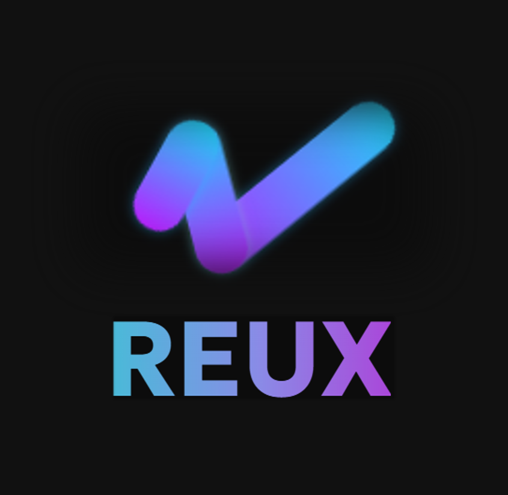
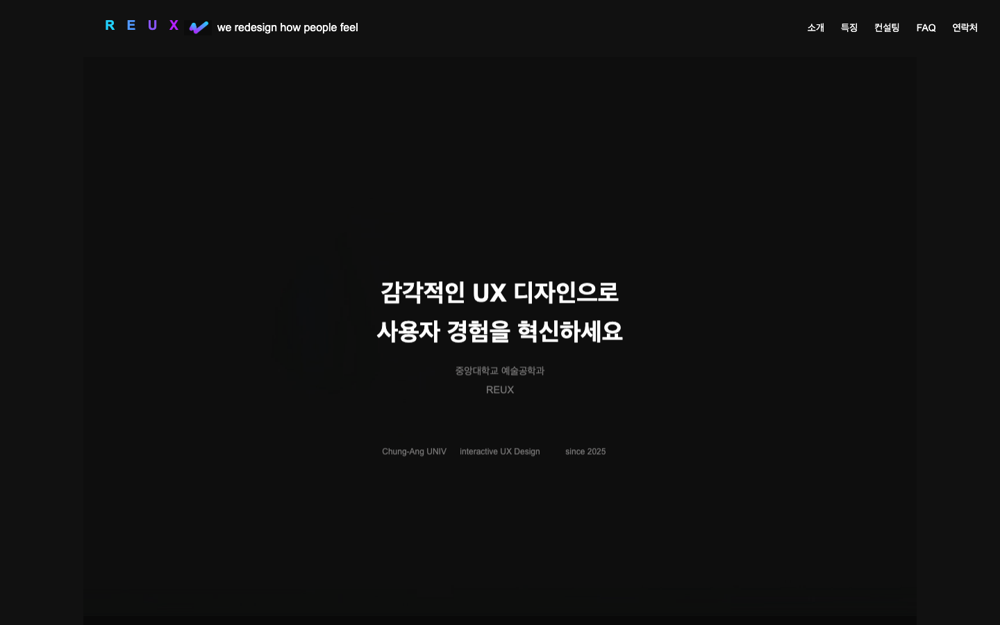
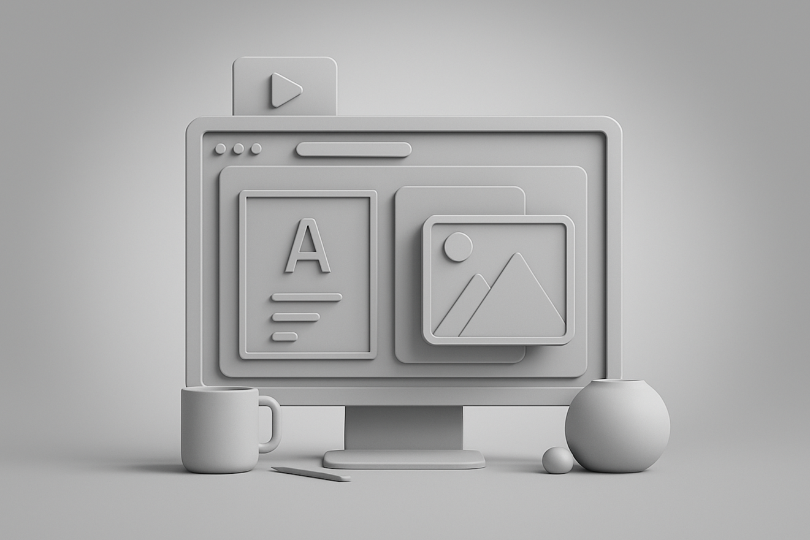
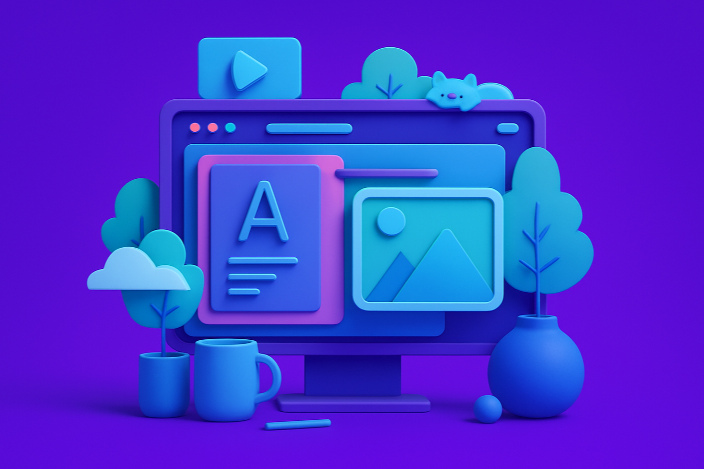

<div align="center">



# REUX

**we redesign how people feel**

감각적인 인터랙션과 애니메이션으로 사용자 경험을 다시 설계하는 UX 브랜드 웹사이트

중앙대학교 예술공학과 · 2025




</div>

## REUX란?

| | | |
| :---: | --- | --- |
| **R** | Redesign | 다시 설계하고 |
| **E** | Enhance | 향상시키고 |
| **U** | Understand | 이해시키고 |
| **X** | eXecute | 실제로 실행합니다 |

REUX는 사용자의 감각을 자극하는 인터랙션과 애니메이션으로 더 몰입감 있는 웹 경험을 만드는 UX 디자인 방법론입니다.

## 페이지 구성

| # | 섹션 | 내용 |
| :---: | --- | --- |
| – | 인트로 | 로고 영상과 R·E·U·X 글자 애니메이션 |
| 01 | REUX란? | 브랜드 소개, 업종 키워드가 흐르는 루프 텍스트 |
| 02 | 사용자 경험이란? | 인트로 영상에서 반복 영상으로 이어지는 배경 |
| 03 | 나쁜 UX | 일부러 불편하게 만든 웹페이지 목업 |
| 04 | 좋은 UX | 6가지 UX 원칙 카드, Before / After 스크롤 비교 |
| 05 | 컨설팅 신청 | 서비스 상태, 문제, 개선 영역을 고르는 신청 폼 |
| 06 | FAQ | 아코디언 형식의 자주 묻는 질문 |
| – | 연락처 | 문의 안내 |

<p align="center">
  
  
</p>

## 실행 방법

빌드 과정이 없는 정적 사이트입니다. `index.html`을 브라우저로 열면 바로 볼 수 있습니다.

로컬 서버로 띄우려면:

```bash
python3 -m http.server 8000
# http://localhost:8000 접속
```

GSAP과 jQuery는 CDN에서 불러오므로 인터넷 연결이 필요합니다.

## 폴더 구조

```
REUX_project/
├── index.html          # 페이지 마크업
├── styles.css          # 스타일
├── script.js           # 인터랙션 · 스크롤 애니메이션
├── assets/
│   ├── images/         # 로고, 작업물, Before/After 이미지
│   └── videos/         # 로고 · 인트로 영상
└── docs/               # README용 스크린샷
```

## 사용 기술

- HTML5 / CSS3 / Vanilla JavaScript
- [GSAP 3.12](https://gsap.com/) + ScrollTrigger: 스크롤 기반 애니메이션
- [jQuery 3.7](https://jquery.com/)
